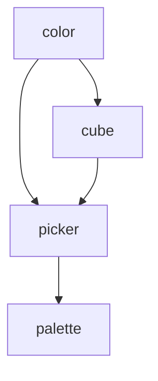

<!-- Generated by the tasks CLI. Edit tasks/ and run `tasks render`; never edit this file. -->

# HSL Cube Picker — Tasks

A mobile-first HSL color picker built as a cube: the grid shows two variables and the
slider ("ceiling") the third; swiping turns the cube to swap them, and zoom refines the
grid. The demo is a palette page that opens the picker and keeps the chosen colors.

- **What and why:** [hsl-picker/requirements.md](hsl-picker/requirements.md)
- **How:** [hsl-picker/design-spec.md](hsl-picker/design-spec.md). Where the two
  disagree, the spec wins. Each task links the spec sections it implements.

> **Progress log:** one file per epic under [progress/](progress/) records _how_ each task is carried
> out. Before starting a task, read your epic's progress file in full, plus the `Epic summary` of
> every epic it depends on; log as you work with `tasks log <id> "…"`.

## Design

Stack: Solid, Panda CSS v2, Vite+ (`vp check`, `vp test`, `vp build`), Vitest with
jsdom, Storybook. Pure functions over classes; every rule that can be pure is, and is
unit-tested without the DOM.

### Architecture

- **`color`** (`src/color/`) — color types and conversions, independent of any picker.
  HSL now; OKLCH, LAB and gamut mapping later.
- **`cube`** (`src/hsl/`) — the pure HSL cube model: faces and turns, the zoom lattice,
  face data (cells, peek strips, ceiling), the picker reducer, and gesture
  classifiers. No Solid or DOM imports.
- **`picker`** (`src/picker/`, plus `src/hsl/theme.ts`, `src/hsl/motion.ts` and
  `panda.config.ts`) — Solid components, the adaptive light/dark theme, transitions
  and gesture wiring. Components render state and translate events into reducer
  actions; they hold no logic beyond wiring.
- **`palette`** (`src/palette/`, `src/App.tsx`) — the demo host: palette page,
  persistence, and removal of the old slider demo.

## Dependencies

Epic rollup, derived from the open tasks' dependencies (a cycle here is not a defect):

## Tasks

**Legend:** `[ ]` todo · `[~]` doing · `[x]` done · `[-]` closed. Each task file's frontmatter is the source of truth; query with `tasks ready`, `tasks show <id>`.

### color — [progress](progress/color.md)
**Color spaces**
> Color types and conversions independent of any picker: HSL now, later OKLCH, LAB and gamut mapping.

- [x] [HSL color core](tasks/color/hsl.md) — Hsl type, normalize/round, toCss, toHex, contrastInk in src/color/

### cube — [progress](progress/cube.md)
**HSL cube model**
> The pure HSL cube: faces and turns, the zoom lattice, face data, the picker reducer, and gesture classifiers. No Solid or DOM.

- [ ] [Gesture classifiers](tasks/cube/gestures.md) — pointerGesture, pinchProgress, velocity, wheel reducer in gestures.ts · **waits on** `cube/reducer`
- [ ] [Cube, lattice and face data](tasks/cube/model.md) — cube.ts, lattice.ts, face.ts: faces, turns, axisWindow, faceCells, peekStrips, ceilingStops
- [ ] [Picker reducer](tasks/cube/reducer.md) — PickerState, PickerAction, pickerReducer in state.ts · **waits on** `cube/model`

### picker — [progress](progress/picker.md)
**Picker components**
> Solid components of `HslPicker`, the adaptive theme, transitions and gesture wiring.

- [ ] [PickerFace and HslPicker composition](tasks/picker/compose.md) — public HslPicker: controlled/uncontrolled, confirm/cancel, live region · **waits on** `picker/face-grid`, `picker/depth-panel`, `picker/peek-zoom`
- [ ] [Ceiling, DepthPanel and DepthSlider](tasks/picker/depth-panel.md) — collapsed ceiling button, expanded panel with vertical depth slider, focus handling · **waits on** `cube/model`, `cube/reducer`, `picker/theme`
- [ ] [FaceGrid](tasks/picker/face-grid.md) — 5 x 7 patch radiogroup: roving focus, keyboard, ring variants, stories · **waits on** `cube/model`, `cube/reducer`, `picker/theme`
- [ ] [Gesture wiring](tasks/picker/gesture-wiring.md) — useGestures.ts: tracked drag and pinch, panel drag, wheel, dblclick · **waits on** `cube/gestures`, `picker/compose`, `picker/transitions`
- [ ] [PeekStrip and ZoomControl](tasks/picker/peek-zoom.md) — edge peek-strip buttons and the zoom -/level/+ control · **waits on** `cube/model`, `cube/reducer`, `picker/theme`
- [ ] [Theme, schemes and fonts](tasks/picker/theme.md) — Panda light/dark schemes, surface texture, fonts, theme.ts (screenScheme, tintedSurface)
- [ ] [Transitions and animations](tasks/picker/transitions.md) — motion.ts + transition.ts: triggered/tracked turn, zoom, panel drop; settling; reduced motion · **waits on** `picker/compose`

### palette — [progress](progress/palette.md)
**Palette demo**
> The palette page that hosts the picker and persists the chosen colors.

- [ ] [Palette page and persistence](tasks/palette/page.md) — PalettePage, storage.ts, replace App.tsx, remove Slider.tsx · **waits on** `picker/compose`
